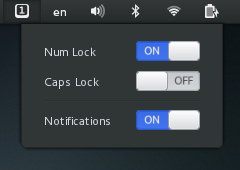

## Gnome shell numlock&capslock state indicator extension.

It shows notifications about numlock or capslock state change.

The extension is available at: https://extensions.gnome.org/extension/36/lock-keys/

In order to manually install this extension, 
* Download extension from https://github.com/kazysmaster/gnome-shell-extension-lockkeys
* Extract the downloaded zip file
* Copy lockkeys@vaina.lt folder to the `~/.local/share/gnome-shell/extensions`
* Run `glib-compile-schemas ~/.local/share/gnome-shell/extensions/lockkeys@vaina.lt/schemas` in terminal
